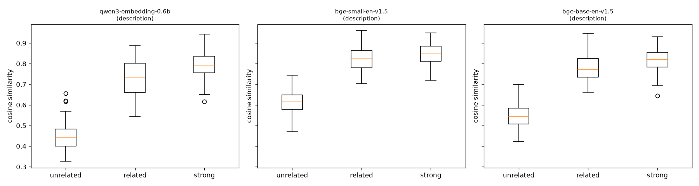

# Embedding model benchmark — 2026-10-13

Test set: 245 labelled skill pairs (2 = strongly related, 1 = related, 0 = unrelated), 42 neighbour queries over a 283-skill vocabulary.

**Selection rule (fixed before running):** highest average of ROC-AUC(related) and Recall@5, with RAM ≤ 1.5 GB and ≥ 100 skills/second; if two are within 0.02, prefer the smaller model.

## Results

| Model | Text | Score | AUC related | AUC strong | Spearman | Recall@5 | MRR | Separation d | Partial thr | Match thr | Match P/R | RAM MB | ms/skill | Eligible |
|---|---|---|---|---|---|---|---|---|---|---|---|---|---|---|
| qwen3-embedding-0.6b | description | **0.869** | 0.997 | 0.855 | 0.776 | 0.740 | 0.945 | 5.35 | 0.585 | 0.686 | 0.69/0.96 | 1880 | 638.75 | no |
| bge-small-en-v1.5 | description | **0.858** | 0.996 | 0.807 | 0.723 | 0.720 | 0.927 | 4.27 | 0.720 | 0.776 | 0.64/0.95 | 621 | 5.65 | yes |
| bge-base-en-v1.5 | description | **0.849** | 0.998 | 0.835 | 0.754 | 0.700 | 0.964 | 4.57 | 0.685 | 0.719 | 0.64/0.96 | 941 | 21.87 | no |
| all-MiniLM-L6-v2 | description | **0.842** | 0.996 | 0.806 | 0.721 | 0.689 | 0.920 | 4.19 | 0.375 | 0.431 | 0.64/0.89 | 574 | 2.89 | yes |
| qwen3-embedding-0.6b | name | **0.840** | 0.991 | 0.850 | 0.766 | 0.688 | 0.937 | 4.11 | 0.602 | 0.674 | 0.65/0.92 | 1880 | 405.17 | no |
| gte-modernbert-base | description | **0.816** | 0.980 | 0.812 | 0.715 | 0.652 | 0.903 | 3.45 | 0.673 | 0.727 | 0.63/0.88 | 761 | 330.51 | no |
| bge-base-en-v1.5 | name | **0.676** | 0.921 | 0.773 | 0.627 | 0.432 | 0.738 | 2.20 | 0.580 | 0.665 | 0.71/0.59 | 941 | 6.25 | yes |
| all-MiniLM-L6-v2 | name | **0.626** | 0.869 | 0.720 | 0.528 | 0.383 | 0.680 | 1.59 | 0.288 | 0.318 | 0.60/0.65 | 574 | 1.09 | yes |
| bge-small-en-v1.5 | name | **0.601** | 0.869 | 0.718 | 0.526 | 0.333 | 0.621 | 1.67 | 0.629 | 0.653 | 0.61/0.71 | 621 | 1.97 | yes |
| gte-modernbert-base | name | **0.596** | 0.834 | 0.714 | 0.495 | 0.357 | 0.604 | 1.45 | 0.679 | 0.679 | 0.62/0.64 | 761 | 88.74 | no |

**Models that could not run:**

- embeddinggemma-300m: GatedRepoError: 401 Client Error. (Request ID: Root=1-6ace2ac6-6e24f6d517614a8900d71ff3;dedc23ab-f870-44aa-ab11-bffe1d1ca5fd)

Cannot access gated repo for url https://huggingface.co/google/embeddinggemma-300m/resolve/main/modules.json.
Access to model google/embeddinggemma-300m is restricted. You must have access to it and be authenticated to access it. Please log in.

## Mean similarity by label

| Model | Text | Unrelated (0) | Related (1) | Strong (2) |
|---|---|---|---|---|
| qwen3-embedding-0.6b | description | 0.447 ± 0.064 | 0.729 ± 0.084 | 0.792 ± 0.065 |
| bge-small-en-v1.5 | description | 0.614 ± 0.058 | 0.822 ± 0.061 | 0.847 ± 0.051 |
| bge-base-en-v1.5 | description | 0.550 ± 0.062 | 0.779 ± 0.068 | 0.817 ± 0.055 |
| all-MiniLM-L6-v2 | description | 0.107 ± 0.098 | 0.533 ± 0.140 | 0.580 ± 0.126 |
| qwen3-embedding-0.6b | name | 0.466 ± 0.075 | 0.720 ± 0.082 | 0.778 ± 0.077 |
| gte-modernbert-base | description | 0.580 ± 0.065 | 0.760 ± 0.065 | 0.787 ± 0.055 |
| bge-base-en-v1.5 | name | 0.496 ± 0.056 | 0.633 ± 0.082 | 0.668 ± 0.095 |
| all-MiniLM-L6-v2 | name | 0.175 ± 0.089 | 0.356 ± 0.132 | 0.404 ± 0.183 |
| bge-small-en-v1.5 | name | 0.556 ± 0.058 | 0.673 ± 0.086 | 0.690 ± 0.098 |
| gte-modernbert-base | name | 0.600 ± 0.054 | 0.682 ± 0.071 | 0.700 ± 0.082 |

## Recommended: all-MiniLM-L6-v2 (description text)

- Matched threshold: **0.431** (precision 0.64, recall 0.89)
- Partial threshold: **0.375** (precision 1.00, recall 0.93)

### Mean similarity by category

- adjacent (label 1): 0.471
- alternatives (label 1): 0.589
- framework-family (label 2): 0.639
- framework-language (label 2): 0.662
- hard-name-overlap (label 0): 0.189
- hard-name-overlap (label 1): 0.519
- language-family (label 2): 0.557
- same-domain (label 2): 0.553
- tech-vs-nontech (label 0): 0.056
- tool-ecosystem (label 2): 0.564
- unrelated-tech (label 0): 0.124

### 15 pairs it gets most wrong

| A | B | Label | Similarity |
|---|---|---|---|
| Statistics | A/B Testing | 2 | 0.218 |
| Tableau | Power BI | 1 | 0.872 |
| MySQL | PostgreSQL | 1 | 0.843 |
| TensorFlow | PyTorch | 1 | 0.814 |
| Django | Flask | 1 | 0.799 |
| SEO | Digital Marketing | 2 | 0.305 |
| Jest | Mocha | 1 | 0.782 |
| Vue.js | Svelte | 1 | 0.772 |
| Machine Learning | Deep Learning | 2 | 0.333 |
| IoT | Embedded Systems | 2 | 0.341 |
| Cypress | Playwright | 1 | 0.734 |
| Firebase | Supabase | 1 | 0.73 |
| React | Vue.js | 1 | 0.725 |
| Figma | Adobe XD | 1 | 0.725 |
| Airflow | ETL | 2 | 0.384 |

