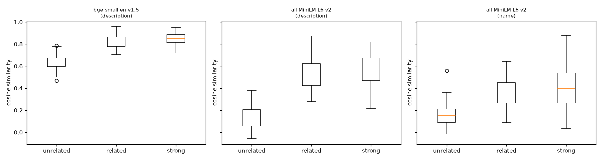

# Embedding model benchmark — 2026-10-14

Test set: 337 labelled skill pairs (102 strongly related, 71 related, 164 unrelated — of which 92 are hard negatives: technical skills from different areas), 42 neighbour queries over a 283-skill vocabulary.

**Selection rule (fixed before running):** highest average of ROC-AUC(related) and Recall@5, with RAM ≤ 1.5 GB and ≥ 100 skills/second; if two are within 0.02, prefer the smaller model.

## Results

| Model | Text | Score | AUC related | AUC strong | Spearman | Recall@5 | MRR | Separation d | Partial thr | Match thr | Match P/R | RAM MB | ms/skill | Eligible |
|---|---|---|---|---|---|---|---|---|---|---|---|---|---|---|
| bge-small-en-v1.5 | description | **0.857** | 0.993 | 0.881 | 0.829 | 0.720 | 0.927 | 3.89 | 0.720 | 0.776 | 0.64/0.95 | 619 | 8.00 | yes |
| all-MiniLM-L6-v2 | description | **0.842** | 0.995 | 0.880 | 0.830 | 0.689 | 0.920 | 3.90 | 0.379 | 0.384 | 0.62/0.96 | 572 | 3.75 | yes |
| all-MiniLM-L6-v2 | name | **0.635** | 0.886 | 0.790 | 0.643 | 0.383 | 0.680 | 1.71 | 0.257 | 0.242 | 0.51/0.83 | 572 | 1.63 | yes |
| bge-small-en-v1.5 | name | **0.595** | 0.857 | 0.770 | 0.596 | 0.333 | 0.621 | 1.59 | 0.629 | 0.653 | 0.58/0.71 | 619 | 3.36 | yes |

## Hard case: related skills vs technical skills from different areas

Use these columns to choose the 'related' threshold for career matching. Thr@P95 is the lowest similarity at which at least 95% of pairs called 'related' really are related.

| Model | Text | AUC vs hard neg | Hard neg mean | Hard neg max | Thr@P95 | Recall@P95 | Thr@P90 | Recall@P90 |
|---|---|---|---|---|---|---|---|---|
| bge-small-en-v1.5 | description | 0.990 | 0.651 | 0.786 | 0.733 | 0.94 | 0.703 | 1.00 |
| all-MiniLM-L6-v2 | description | 0.994 | 0.160 | 0.378 | 0.329 | 0.97 | 0.269 | 0.99 |
| all-MiniLM-L6-v2 | name | 0.900 | 0.145 | 0.360 | 0.323 | 0.62 | 0.282 | 0.71 |
| bge-small-en-v1.5 | name | 0.848 | 0.571 | 0.695 | 0.677 | 0.56 | 0.636 | 0.72 |

## Mean similarity by label

| Model | Text | Unrelated (0) | Related (1) | Strong (2) |
|---|---|---|---|---|
| bge-small-en-v1.5 | description | 0.635 ± 0.059 | 0.822 ± 0.061 | 0.847 ± 0.051 |
| all-MiniLM-L6-v2 | description | 0.137 ± 0.100 | 0.533 ± 0.140 | 0.580 ± 0.126 |
| all-MiniLM-L6-v2 | name | 0.158 ± 0.089 | 0.356 ± 0.132 | 0.404 ± 0.183 |
| bge-small-en-v1.5 | name | 0.564 ± 0.053 | 0.673 ± 0.086 | 0.690 ± 0.098 |

## Recommended: all-MiniLM-L6-v2 (description text)

- Matched threshold: **0.384** (precision 0.62, recall 0.96)
- Partial threshold: **0.379** (precision 1.00, recall 0.92)

### Mean similarity by category

- adjacent (label 1): 0.471
- alternatives (label 1): 0.589
- framework-family (label 2): 0.639
- framework-language (label 2): 0.662
- hard-name-overlap (label 0): 0.189
- hard-name-overlap (label 1): 0.519
- hard-negative-tech (label 0): 0.160
- language-family (label 2): 0.557
- same-domain (label 2): 0.553
- tech-vs-nontech (label 0): 0.056
- tool-ecosystem (label 2): 0.564
- unrelated-tech (label 0): 0.124

### 15 pairs it gets most wrong

| A | B | Label | Similarity |
|---|---|---|---|
| Tableau | Power BI | 1 | 0.872 |
| MySQL | PostgreSQL | 1 | 0.843 |
| TensorFlow | PyTorch | 1 | 0.814 |
| Django | Flask | 1 | 0.799 |
| Jest | Mocha | 1 | 0.782 |
| Vue.js | Svelte | 1 | 0.772 |
| Cypress | Playwright | 1 | 0.734 |
| Statistics | A/B Testing | 2 | 0.218 |
| Firebase | Supabase | 1 | 0.73 |
| React | Vue.js | 1 | 0.725 |
| Figma | Adobe XD | 1 | 0.725 |
| Java | Kotlin | 1 | 0.706 |
| AWS | Microsoft Azure | 1 | 0.663 |
| C | C++ | 1 | 0.661 |
| SEO | Digital Marketing | 2 | 0.305 |

